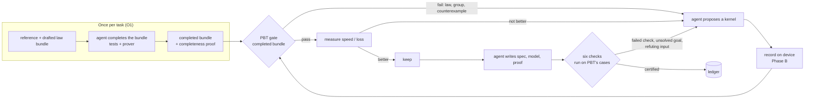

# Autokernel generation: the pipelines we propose

**The task.** An agent writes or optimizes a kernel for one backend, and a loop keeps a candidate
only if it is correct *and* better: faster, or lower loss downstream. In kernel work, search
pressure and correctness pressure point in opposite directions. Dropping a max-subtraction, a
centering or a divide makes a kernel 1.11–2.40× faster and still produces plausible output
([findings](../findings.md) #2). So the correctness gate is half of the fitness function, not a
check bolted onto the loop. These pipelines differ in what that half is made of.

Status tags as in [`findings.md`](../findings.md): **[M]** measured · **[B]** built · **[planned]**.

## The shared substrate  [B]

Every pipeline below runs on the same record/replay core
([`src/autokernel_pbt/props/`](../../src/autokernel_pbt/props/), entry point
`driver.run_task` / `driver.read_run`):

```
A  generate   seeded case groups: base inputs + metamorphic partners (shift, permute, …),
              over a shape ladder that includes degenerate and partial-tile shapes
B  execute    the whole batch on one backend (NumPy or Triton), persisting inputs, outputs
              and telemetry; inputs are read-only during execution
C  score      any oracle arm, offline, over the byte-identical recorded table
D  shrink     on failure only (designed, not built)
```

Because scoring is offline, one device run can be re-scored by a new oracle months later, and
competing gates are compared on identical executions.

## The pipelines

| ID | Gate | Feedback to the agent | Status | Where |
|---|---|---|---|---|
| **G0** | `allclose` against a reference (the field default) | pass / fail | arm built; measured as a baseline | `AllcloseOracle` in [`props/oracle.py`](../../src/autokernel_pbt/props/oracle.py) |
| **G1** | **PBT gate**: the declarative law bundle decides, and the reference and hybrid arms are scored alongside | the failing law and group | **[M]** on CPU | [`experiments/generation/autoresearch-pbt/`](../../experiments/generation/autoresearch-pbt/) |
| **G2** | G1 with the **completed** bundle (log-ratio and affine-tie laws) | as G1 | softmax half **[M]** offline (`bundle="completed"`); layernorm [planned] E2 | [`experiments/generation/e2-log-ratio-law/`](../../experiments/generation/e2-log-ratio-law/) |
| **G3** | G2, red-teamed: a runtime objective, no forbidden-hack list, a hidden checker re-scoring every admitted kernel | as G1 | [planned] E3 | — |
| **G4** | G2 plus a **post-hoc formal certificate** on each kept kernel: six checks, every claim executed on PBT's cases | certificate / failed check | core **[B]**; adapters and pilot [planned] E1 | [`src/autokernel_pbt/formal/`](../../src/autokernel_pbt/formal/) |
| **G5** | G4 with **formal feedback returned to the agent**: failed checks, unsolved goals, refuting inputs | proof-state feedback | [planned] E4 | — |
| **O1** | (offline, once per task) an agent **completes the oracle**, with tests only or with tests and a prover | completed laws, proof of completeness | ran, unscored | [`experiments/verification/oracle-research/`](../../experiments/verification/oracle-research/) |

The full loop we are building toward (G5, with O1 run once per task beforehand):



## What each step adds, and why it is ordered this way

**G0 → G1: calibration.** On the A10, `allclose` rejects 10 of 54 correct-kernel groups and G1's
arms reject none. In the CPU loop it rejects the loop's own correct baseline layernorm on 5 of 9
groups, so a G0 loop cannot get past iteration 0. G1 is
measured: a 26-candidate loop took `val_bpb` from 2.829 to 2.228 (−21.2%) at +27.7% throughput,
and six faster-but-wrong saboteurs were all caught.

**G1 → G2: completeness.** G1's bundle admits ten wrong-kernel families, among them a constant fill
52–54× faster than softmax. A speed objective with a G1 gate would converge to it. Proposition 1 says
which laws close the gap, so G2 is a known edit. It still needs float tolerances, and inputs that
match the real call site, such as `-inf`-masked rows. *Success criterion:* every family the proof
says G1 admits is admitted by G1 and rejected by G2, with no new false positive on the 26 loop
candidates or the 54 device groups.

**G2 → G3: measure the gate, not the agents.** G1 rejected 0 candidates because the instructions
named the hacks and the agents complied. G3 removes the list and lets a hidden checker count what
slips through, under the old and the completed bundle.

**G3 → G4: certificates, not a proof gate.** Proofs come *after* the gate accepts, so a hard proof
obligation never caps the speedup. A proof gate is a known trap: 0.24× best-provable against 1.03×
best-tested on GEMM. The agent writes the spec too, so spec gaming is measured rather than
forbidden: C2 catches a spec that is the kernel itself, and C3 catches a spec made of the gate's
own incomplete laws.

**G4 → G5: does proof feedback help beyond a better gate?** Verifier feedback is known to help
verified code generation. It has not been tested for numerical kernels. The positioning review
recommends this as the centerpiece experiment.

## Known limits that every generation pipeline inherits

- A spec or law set can only be shown complete against the wrong kernels someone has written. C3
  is a lower bound.
- Axiomatized primitives can be blind to scale. A proof "with respect to `exp`" from axioms
  alone, as in Why3 or core Lean without Mathlib, is temperature-blind unless a rigidity axiom
  such as `1 + x ≤ exp x` is present, so G4 audits every primitive an agent assumes (C6). A
  language that defines `exp` (Lean with Mathlib) does not have this gap.
- Device results so far come from one A10, float32 only. Data-type semantics, 58 of the 301
  bugs in the taxonomy we use, is almost entirely outside today's corpus.

## Entry points

```bash
# G1, the measured loop (its own venv; see that README)
cd experiments/generation/autoresearch-pbt && .venv/bin/python runner.py baseline

# record a task on a device (the substrate); scoring happens later, offline on CPU
python scripts/gpu_record.py --help

# the certificate core's tests
pytest tests/unit/formal tests/spec/test_0009_formal_core.py -q
```
