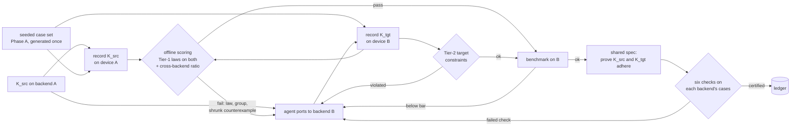

# Autokernel translation: the pipelines we propose

> **Status: the first pair has run on a device once.** The first backend pair has its
> infrastructure: a CUDA backend (feature 0012), scoring of a port against the known kernel's
> recorded outputs (feature 0013), and a proof, in Lean, Rocq and Isabelle, that the known Triton
> kernels and their CUDA ports compute the same function in exact arithmetic
> (`proofs/cross-setup-reductions/`). **TE1 ran on 2026-10-20** on one RTX A6000, and all eight
> pre-registered predictions hold (P2 only after a telemetry fix made before any row was
> recorded): on a correct port T1 and the Tier-1 laws reject nothing, and T0 rejects 2 of 9
> layernorm groups
> (`docs/measurements/2026-10-12-te1-triton-to-cuda-prereg.md`). Each claim below is marked as
> evidence we have, built, or a gap. Comments and changes are welcome: open a PR against this
> file.
>
> **Priority (decided 2026-10-11): GPU first.** The first backend pair is GPU to GPU on NVIDIA
> hardware, the stack this repository already records on. **The proposed direction is Triton →
> CUDA** (2026-10-12, following the segment's framing of mapping *known* kernels): the recorded
> Triton ladder is the known kernel. Cross-vendor GPU (CUDA →
> HIP on AMD) comes next, and TPU (Pallas) and Trainium (NKI) after that.

## The goal

**Map known kernels from one setup to another, and use property-based testing and formal
verification together so that the port is higher quality, more performant and consistent with
the kernel it came from.** The three words name three different guarantees, and the two methods
split them:

| goal | what it means for a port | who establishes it |
|---|---|---|
| **consistent** | computes the same function as the known kernel | **formal proof** for the exact-arithmetic structure — reduction trees, masks and tails, strides, identities — in Lean, Rocq and Isabelle, of one shared statement; **PBT** for the floating-point gap, by the cross-setup ratio on byte-identical recorded inputs |
| **higher quality** | correct, and no false alarm blocks a correct port | **PBT**: the Tier-1 laws and the calibrated ratio, which accept correct-but-different ports that `allclose` rejects; **FV** keeps the laws honest about what they admit (findings #4) |
| **more performant** | meets or beats the target's performance bar | the loop's benchmark on the target, gated by the two above; proofs are post-hoc certificates, never the loop's filter (a hard proof gate is a known performance trap) |

Each method checks the other. A proof is about a *model* of the kernel; PBT executes the model's
claims against the recorded kernel (check C4 of the formal design), so a proof about the wrong
model is caught. PBT samples; the proof covers every row width and every block width, including
the ones the corpus never reaches.

**The task.** An agent ports a kernel `K_src`, written for one backend, to `K_tgt` on another.
In priority order: CUDA ↔ Triton on an NVIDIA GPU; CUDA → HIP on an AMD GPU; then a TPU kernel in
Pallas/JAX, or Trainium via NKI. The loop keeps a port only if it computes the same function as
the source and meets the target's performance bar.

**What GPU first changes.** With both kernels on one device, both are recorded in the same
session on byte-identical inputs, and the source's outputs are a reference on the same hardware.
The ports still differ in the last bits, because a CUDA kernel and a Triton kernel reduce in
different orders, with different tile widths, and may use different intrinsics (`__expf` and
fast-math against `tl.exp`). That is the regime this repository has already measured on Triton:
the `log2 n` ratio, the tile-aware bound `log2(tile) + n_tiles`, and the tile-tail defect. The
first gap is a CUDA backend.

**Why it is harder than generation, for the gate.**

1. **There is often no second implementation on the target device.** Current NKI practice is a
   hand-written NumPy reference on the CPU compared by `np.allclose`, and the source kernel runs
   on a different device. That is where laws are needed: where a reference exists they catch the
   same bugs it does ([findings](../findings.md), "detection is a tie"), and they need no
   reference at all, provided the bundle is complete (findings #4).
2. **The two backends round differently by design.** Accumulation order, tile shapes and
   accumulator width all differ. For example, XLA on a TPU computes float32 matrix products with
   bfloat16 multiplies at its default precision; whether a given Pallas kernel's `dot` does the
   same has to be checked per kernel. A correct port is therefore *correct but different* in the last
   bits on every element, which is the regime where `allclose` raised 18.5% false alarms on one
   backend ([findings](../findings.md) #1).
3. **The field default is compile-and-compare.** The only NKI kernel-generation paper we found
   (NKI-Agent) verifies by compiling and comparing outputs
   (`reference/PBT-property-based-testing/README.md`), and the NKI getting-started guide has no
   validation guidance at all (`reference/PBT-property-based-testing/NOTES.md` §5.5).

## The equivalence contract

The parent design splits properties into two tiers, and the split is what makes translation
tractable (design §3.4):

- **Tier 1, portable.** Pure functions of (inputs, outputs) that hold for any correct
  implementation on any backend: algebraic laws, metamorphic relations, and the normalized
  reference ratio. **This is the cross-backend equivalence contract.** The source and the port
  must satisfy the same Tier-1 bundle on the same seeded cases.
- **Tier 2, backend-specific.** Target constraints that are not functions of (inputs, outputs):
  Triton block and mask limits; NKI tile, SBUF/PSUM capacity and layout; TPU VMEM tiling and
  Pallas `BlockSpec` shapes; sanitizer output. These must be captured *during* execution on the
  target device.

*Evidence we have:* Tier-1 laws moved from NumPy to Triton **unchanged**, with no false failure
up to 29.4 M elements at 78% of peak bandwidth ([findings](../findings.md) #3). That
is one backend pair, so it answers the design's open question 2 ("which properties fail to
transfer?") for NumPy → Triton only.

## The pipelines

| ID | Equivalence check | Needs a target reference? | Status |
|---|---|---|---|
| **T0** | `allclose(K_tgt(x), K_src(x))` on shared inputs, or compile-and-compare | yes (the source's outputs) | the field default; the baseline arm. [B] as `allclose_source` (feature 0013) |
| **T1** | **Differential PBT across backends**: one seeded case set, recorded once on each device, scored offline with the normalized reference ratio, using `K_src`'s recorded outputs as the reference and a tolerance derived for *both* backends' accumulation | no (source outputs suffice) | [B] for CUDA: `reference_source` (feature 0013) scores a port against the source's recording, keyed by input bytes; the cross-backend tolerance is still the single-backend `log2 n` ratio until TE2 |
| **T2** | **Law-only acceptance**: the completed Tier-1 bundle on the target alone | no | [proposed]; needs E2's completed bundles first |
| **T3** | T1 + T2 + **Tier-2 target constraints** captured on the device | no | [proposed]; needs a target backend |
| **T4** | T3 + **consistency certificates**: the source and the port are proved to compute one spec's function — in Lean, Rocq and Isabelle — with the six checks run on each backend's own recorded cases | no | [proposed]; the reference certificate for the ladder exists (`proofs/cross-setup-reductions/`, Lean, Rocq and Isabelle); agent-written ones need feature 0010 adapters |

The full loop:

**Why this shape.** The case set is generated once and is backend-neutral, so both devices see
byte-identical inputs. Each device is used once per candidate, in batch. All comparison happens
offline, so a new oracle or a revised tolerance can re-score every port without renting the
hardware again. The record/replay design exists for exactly this. Shrinking (Phase D) matters
more here than in generation, because a minimal counterexample is the most useful repair hint for
a port.

## What exists today, and what each pipeline still needs

| Component | Status |
|---|---|
| Backend-neutral case generator, case groups, execution table, offline scoring | **built** (`src/autokernel_pbt/props/`) |
| Rows carry `backend`; a run is scored without a device | **built** |
| NumPy (CPU) and Triton (GPU) backends | **built** |
| Tier-1 laws transfer NumPy → Triton | **measured** |
| A **CUDA C++ backend**: NVRTC to PTX, the driver API, torch's buffers, telemetry schema v2 | **measured** (feature 0012): 62 of 62 rows `ok` on an RTX A6000 in TE1 |
| **CUDA ports of the known Triton ladder** (`kernels/cuda/`) | **measured**: correct on device (TE1); device tests in `tests/gpu/test_cuda_kernels.py` |
| **Scoring a port against the known kernel's recorded outputs** (T0, T1), with the pairing refused unless inputs are byte-identical | **measured** (feature 0013, TE1): `driver.score_translation`, `read_translation` |
| **Proof that the known kernel and its port compute the same function** (exact arithmetic) | **built** in Lean, Rocq and Isabelle/HOL, six theorems each, one shared statement (`proofs/cross-setup-reductions/`) |
| A **HIP backend**, then a **TPU backend** (Pallas/JAX) or an **NKI backend** | **gap**: later targets, in priority order |
| A **cross-backend tolerance**: the `log2 n` ratio assumes pairwise reduction on *one* backend | **not yet needed for the ladder**: in TE1 the single-backend ratio accepts the correct port with a largest ratio of 0.986, against a threshold of 30. TE2 measures it more widely |
| **Numerical characterization of the target** (rounding mode, accumulation order, accumulator width) | **gap**: none is published for Trainium (design open question 3). TPU matrix-unit precision modes are documented, but per-kernel accumulation is not |
| **Completed law bundles** (log-ratio, affine-tie) | **gap**: E2. T2 is unsafe without them, because the current bundles admit wrong kernels (four recorded families, six more probed) |
| A **translation mutation corpus**: plausible wrong ports | **gap**: see TE3 |
| A **benchmark on the target**, so a port is kept only if it meets the performance bar | **gap**: wall-clock is recorded per row, which is not a benchmark |
| Formal adapters (0010), so an *agent's* proof in each language is checked against two backends' recorded cases | **gap** |
| Shrinker (Phase D) | **gap** |

## Proposed experiments

Each should be pre-registered under `docs/measurements/` before it runs, as the
prover-in-the-toolkit experiment was.

- **TE1: do the laws transfer to the target?** First on GPU: port the stock Triton ladder
  kernels to CUDA, record both on one NVIDIA GPU, and score both with every arm, using the
  Triton run as the reference for the CUDA one. Then repeat on AMD, and later on a TPU or
  Trainium. *Falsifier:* any Tier-1 law fails on a port that the cross-backend reference ratio
  accepts.
- **TE2: cross-backend calibration.** False-positive rate of `allclose`, the `log2 n` ratio, a
  target-aware ratio and the law bundle, measured on *correct* ports. This is the translation
  version of the 54-group measurement.
- **TE3: a translation mutation corpus.** Blinded agents write plausible wrong ports in the fault
  classes translation actually produces: layout and stride (row- vs column-major, transposed
  tiles), dtype promotion (bf16 vs fp32 accumulation), reduction order and tile tails, masking,
  and dropped `-inf` handling. Measure detection by T0–T3, tolerance-free detection separately.
- **TE4: the translation loop.** An agent ports a task set under T0 gating versus T3 gating versus
  T3 + T4 feedback. Measure wrong ports admitted (by a hidden checker), time to first correct
  port, and the best correct speedup.

## Open questions for the team

1. **Which direction first?** Decided: GPU first (2026-10-11). Proposed, and built for: Triton →
   CUDA (2026-10-12), because the recorded Triton kernels are the known kernels the segment maps
   from. CUDA → Triton, the common real-world port, would follow once a CUDA kernel is a
   recorded, trusted source. Open to the team.
2. **Which tasks?** The ladder (relu, softmax, layernorm) is what we have. The design names
   attention and GEMM as where translation becomes interesting, and GEMM needs the contraction
   length `K` passed into the ratio explicitly.
3. **Is the source kernel trusted?** T1 treats `K_src` as the reference. If the source itself can
   be wrong, T2 (laws only) becomes the primary gate, and its completeness becomes critical.
