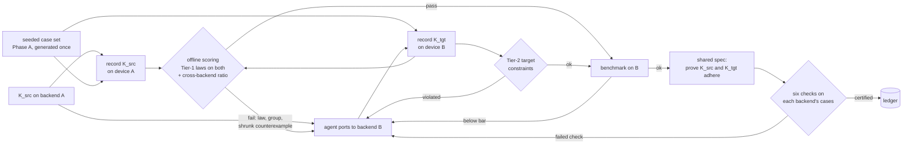

# Autokernel translation: the pipelines we propose

> **Status: proposed.** No translation pipeline has run yet. This page states the design we
> propose for the paper's second task segment, grounded in what the shared substrate already
> does. Each claim is marked as either *evidence we have* or *a gap*. Comments and changes are
> welcome. Open a PR against this file.

**The task.** An agent ports a kernel `K_src`, written for one backend, to `K_tgt` on another.
Examples: CUDA or Triton on a GPU → a TPU kernel in Pallas/JAX; Triton → AWS Trainium via NKI;
CUDA → Triton. The loop keeps a port only if it computes the same function as the source and
meets the target's performance bar.

**Why it is harder than generation, for the gate.**

1. **There is often no trusted second implementation on the target.** A Trainium kernel has no
   reference to diff against except the source, which runs on a different device. That is exactly
   where laws are needed: they catch the same bugs as a reference recompute
   ([findings](../findings.md), "detection is a tie") without needing one.
2. **The two backends round differently by design.** Accumulation order, tile shapes and
   accumulator width all differ. On a TPU, matrix units multiply in bfloat16 by default unless
   higher precision is requested. A correct port is therefore *correct but different* in the last
   bits on every element, which is the regime where `allclose` raised 18.5% false alarms on one
   backend ([findings](../findings.md) #1).
3. **The field default is compile-and-compare.** The only NKI kernel-generation paper we found
   verifies by compiling and comparing outputs, and the NKI getting-started guide has no
   validation guidance at all (`reference/PBT-property-based-testing/NOTES.md` §5.5).

## The equivalence contract

The parent design splits properties into two tiers, and the split is what makes translation
tractable (design §3.4):

- **Tier 1, portable.** Pure functions of (inputs, outputs) that hold for any correct
  implementation on any backend: algebraic laws, metamorphic relations, and the normalized
  reference ratio. **This is the cross-backend equivalence contract.** The source and the port
  must satisfy the same Tier-1 bundle on the same seeded cases.
- **Tier 2, backend-specific.** Target constraints that are not functions of (inputs, outputs):
  Triton block and mask limits; NKI tile, SBUF/PSUM capacity and layout; TPU VMEM tiling and
  Pallas `BlockSpec` shapes; sanitizer output. These must be captured *during* execution on the
  target device.

*Evidence we have:* Tier-1 laws moved from NumPy to Triton **unchanged**, with no false failure
up to 29.4 M elements, and caught a scale-only launch defect ([findings](../findings.md) #3). That
is one backend pair, so it answers the design's open question 2 ("which properties fail to
transfer?") for NumPy → Triton only.

## The pipelines

| ID | Equivalence check | Needs a target reference? | Status |
|---|---|---|---|
| **T0** | `allclose(K_tgt(x), K_src(x))` on shared inputs, or compile-and-compare | yes (the source's outputs) | the field default; the baseline arm |
| **T1** | **Differential PBT across backends**: one seeded case set, recorded once on each device, scored offline with the normalized reference ratio, using `K_src`'s recorded outputs as the reference and a tolerance derived for *both* backends' accumulation | no (source outputs suffice) | [proposed]; the substrate supports it today |
| **T2** | **Law-only acceptance**: the completed Tier-1 bundle on the target alone | no | [proposed]; needs E2's completed bundles first |
| **T3** | T1 + T2 + **Tier-2 target constraints** captured on the device | no | [proposed]; needs a target backend |
| **T4** | T3 + **shared-spec certificates**: the source and the port are each proved to adhere to *one* spec, with the six checks run on each backend's own recorded cases | no | [proposed]; needs feature 0010 adapters |

The full loop:

**Why this shape.** The case set is generated once and is backend-neutral, so both devices see
byte-identical inputs. Each device is used once per candidate, in batch. All comparison happens
offline, so a new oracle or a revised tolerance can re-score every port without renting the
hardware again. The record/replay design exists for exactly this. Shrinking (Phase D) matters
more here than in generation, because a minimal counterexample is the most useful repair hint for
a port.

## What exists today, and what each pipeline still needs

| Component | Status |
|---|---|
| Backend-neutral case generator, case groups, execution table, offline scoring | **built** (`src/autokernel_pbt/props/`) |
| Rows carry `backend`; a run is scored without a device | **built** |
| NumPy (CPU) and Triton (GPU) backends | **built** |
| Tier-1 laws transfer NumPy → Triton | **measured** |
| A **TPU backend** (Pallas/JAX) or an **NKI backend** | **gap**: the first thing T1 needs on a new target |
| A **cross-backend tolerance**: the `log2 n` ratio assumes pairwise reduction on *one* backend | **gap**: needs a derivation for the target's accumulation, as `log2(tile) + n_tiles` was derived for multi-tile Triton |
| **Numerical characterization of the target** (rounding mode, accumulation order, accumulator width) | **gap**: none is published for Trainium (design open question 3). TPU matrix-unit precision modes are documented, but per-kernel accumulation is not |
| **Completed law bundles** (log-ratio, affine-tie) | **gap**: E2. T2 is unsafe without them, because the current bundle admits ten wrong families |
| A **translation mutation corpus**: plausible wrong ports | **gap**: see TE3 |
| Formal adapters (0010), so one spec can be checked against two backends | **gap** |
| Shrinker (Phase D) | **gap** |

## Proposed experiments

Each would be pre-registered under `docs/measurements/` before it runs, like every experiment in
this repository.

- **TE1: do the laws transfer to the target?** Repeat the first and at-scale hardware runs on a
  TPU (and Trainium if available): the stock ladder kernels, ported, scored by every arm.
  *Falsifier:* any Tier-1 law fails on a port that the cross-backend reference ratio accepts.
- **TE2: cross-backend calibration.** False-positive rate of `allclose`, the `log2 n` ratio, a
  target-aware ratio and the law bundle, measured on *correct* ports. This is the translation
  version of the 54-group measurement.
- **TE3: a translation mutation corpus.** Blinded agents write plausible wrong ports in the fault
  classes translation actually produces: layout and stride (row- vs column-major, transposed
  tiles), dtype promotion (bf16 vs fp32 accumulation), reduction order and tile tails, masking,
  and dropped `-inf` handling. Measure detection by T0–T3, tolerance-free detection separately.
- **TE4: the translation loop.** An agent ports a task set under T0 gating versus T3 gating versus
  T3 + T4 feedback. Measure wrong ports admitted (by a hidden checker), time to first correct
  port, and the best correct speedup.

## Open questions for the team

1. **Which backend pair goes first?** CUDA/Triton → TPU (Pallas) is the most accessible. Triton →
   NKI is the one the phase 3a design argued for, since both are Python tile DSLs.
2. **Which tasks?** The ladder (relu, softmax, layernorm) is what we have. The design names
   attention and GEMM as where translation becomes interesting, and GEMM needs the contraction
   length `K` passed into the ratio explicitly.
3. **Is the source kernel trusted?** T1 treats `K_src` as the reference. If the source itself can
   be wrong, T2 (laws only) becomes the primary gate, and its completeness becomes critical.
